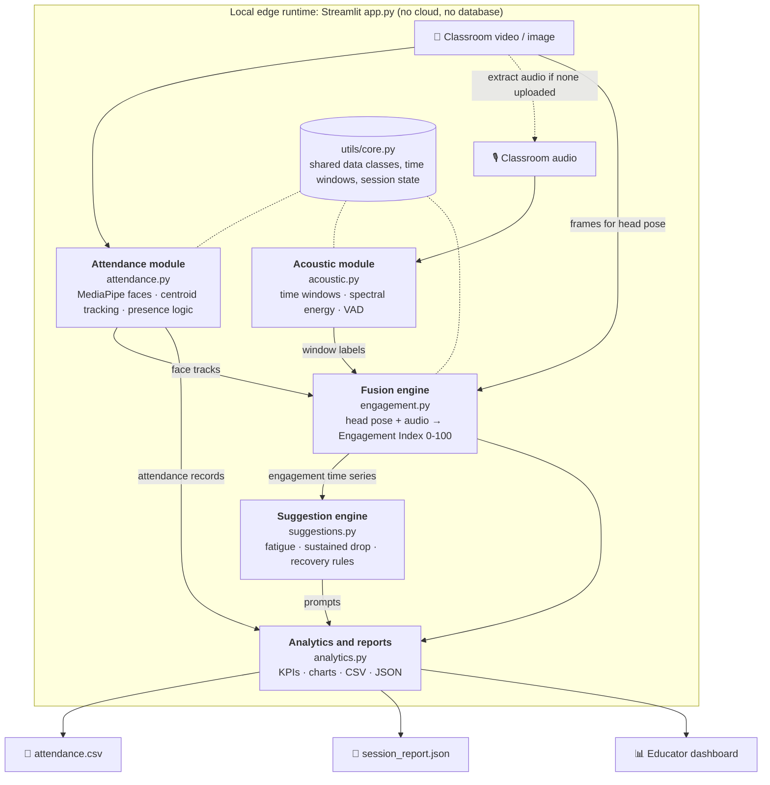
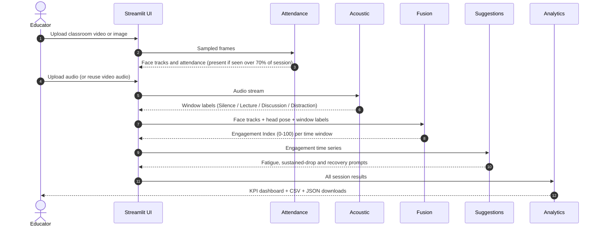

# 🎓 Multimodal Attendance & Engagement Agent

**Skill Wallet — Capstone Project 5**

An AI-powered, privacy-first classroom analytics platform that combines computer vision, acoustic signal processing, and multimodal fusion to deliver real-time attendance tracking and engagement insights for modern educators.

---

## 🔒 Privacy-First Principles

- **100% Offline Edge Processing** — Zero external cloud video transmission
- **Ethical Telemetry Design** — Collective pedagogical feedback, not individual surveillance
- **No Database Dependencies** — Seamless 1-click deployment

---

## 📋 Features

### Tab 1 — Automated Presence-Based Attendance (Epic 2)
- Face detection using MediaPipe
- Centroid-based tracking ID assignment
- Sustained Presence Logic (>70% session time threshold)
- CSV export with Student ID, First/Last Seen, Duration, Status

### Tab 2 — Acoustic Interaction & Noise Dynamics (Epic 3)
- Audio stream segmentation into time windows
- Spectral energy and Voice Activity Detection (VAD)
- Classification: Silence | Instructor Lecture | Student Discussion | Distraction

### Tab 3 — Multimodal Fusion & Engagement Scoring (Epic 4)
- Head pose estimation for visual attentiveness
- Audio-visual signal fusion into unified engagement matrix
- Normalized Engagement Index (0-100) with timeline curves

### Tab 4 — AI Teaching Suggestion Engine (Epic 5)
- Heuristic advisory agent with pattern detection
- Non-intrusive pedagogical prompts
- Fatigue detection, sustained drop alerts, recovery tracking

### Tab 5 — Session Analytics & Educator Report (Epic 5 & 6)
- Comprehensive post-session KPI dashboard
- Participation rates and engagement stability metrics
- Downloadable CSV and JSON reports

---

## 🚀 Quick Start

### Install Dependencies
```bash
pip install -r requirements.txt
```

### Run the Application
```bash
streamlit run app.py
```

---

## 📁 Project Structure

```
capstone-project/
├── app.py                   # Main Streamlit application
├── styles.py                # Custom CSS styling
├── requirements.txt         # Python dependencies
├── .streamlit/
│   └── config.toml          # Streamlit theme configuration
├── utils/
│   ├── __init__.py
│   └── core.py              # Shared data classes and utilities
└── modules/
    ├── __init__.py
    ├── attendance.py         # Face detection & attendance (Tab 1)
    ├── acoustic.py           # Audio analysis & VAD (Tab 2)
    ├── engagement.py         # Multimodal fusion (Tab 3)
    ├── suggestions.py        # AI suggestion engine (Tab 4)
    └── analytics.py          # Reports & charts (Tab 5)
```

---

## 🛠️ Tech Stack

| Technology | Purpose |
|-----------|---------|
| Python 3.9+ | Core language |
| Streamlit | Web dashboard framework |
| OpenCV | Video processing |
| MediaPipe | Face detection & mesh |
| Librosa | Audio signal processing |
| Pandas | Data manipulation |
| Matplotlib | Chart visualization |
| NumPy / SciPy | Numerical computing |

---

## 📊 How It Works

1. **Upload** a classroom video or image → faces are detected and tracked
2. **Upload** audio (or extract from video) → acoustic patterns are classified
3. **Fuse** visual + audio signals → engagement index is computed per time window
4. **Generate** AI suggestions → heuristic engine produces pedagogical prompts
5. **Export** session report → CSV attendance + JSON full analytics

---
---

## 🏗️ System Architecture

The app is a single-process Streamlit application. Each tab maps to one module in `modules/`, and modules exchange typed data classes defined in `utils/core.py`. All processing runs locally, with no cloud calls and no database.



### Module Responsibilities

| Layer | Module | Input | Output |
|-------|--------|-------|--------|
| Presence | `attendance.py` | Video frames or an image | Per-track records: ID, first/last seen, duration, status |
| Acoustic | `acoustic.py` | Audio, or audio extracted from the video | Per-window label: Silence, Instructor Lecture, Student Discussion or Distraction |
| Fusion | `engagement.py` | Head pose and acoustic labels | Engagement Index (0-100) per time window |
| Advisory | `suggestions.py` | Engagement time series | Class-level pedagogical prompts |
| Reporting | `analytics.py` | Outputs of all modules | KPI dashboard, CSV attendance, JSON session report |

---

## 🔄 System Workflow



### Processing Steps

1. **Ingest:** the educator uploads a video or image, and optionally a separate audio file. If no audio is provided, it is extracted from the video.
2. **Detect and track:** MediaPipe detects faces in sampled frames, and a centroid tracker assigns persistent IDs.
3. **Mark attendance:** a student is marked present if seen for more than 70% of the session.
4. **Classify audio:** audio is split into fixed windows, and spectral energy plus VAD assign one of four labels per window.
5. **Estimate attention:** head pose from MediaPipe Face Mesh gives a visual attentiveness score per window.
6. **Fuse:** visual and acoustic scores are combined on the same window boundaries and normalized to a 0-100 Engagement Index.
7. **Advise:** rule-based detectors scan the index timeline and emit non-intrusive teaching prompts.
8. **Report:** participation rate, engagement stability and timelines are computed and exported as CSV and JSON.

### Design Principles

- **Aggregate, not individual:** engagement is computed per class and per time window. Tracking IDs are used only for attendance.
- **Shared time windows:** audio and video scores use the same window boundaries, defined once in `utils/core.py`.
- **Session-state hand-off:** each tab stores its results in `st.session_state`, and later tabs read from it.
- **Tunable thresholds:** the 70% presence threshold and the fusion weights are kept as named constants.
- **Sampled processing:** frames are sampled (about 1-2 per second) to stay responsive on Streamlit Community Cloud.

---

*Built for Streamlit Community Cloud — Zero external database dependencies*
